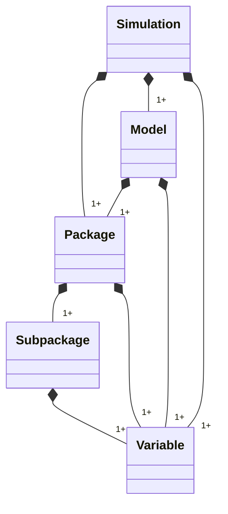

# FloPy 4 software design description (SDD)

<!-- START doctoc generated TOC please keep comment here to allow auto update -->
<!-- DON'T EDIT THIS SECTION, INSTEAD RE-RUN doctoc TO UPDATE -->


- [Conceptual model](#conceptual-model)
- [Object model](#object-model)
  - [Design](#design)
  - [Conventions](#conventions)
- [IO](#io)
  - [Input](#input)
    - [Unified IO](#unified-io)
    - [Conversion](#conversion)
    - [Serialization](#serialization)
      - [Writer](#writer)
      - [Reader](#reader)
  - [Output](#output)

<!-- END doctoc generated TOC please keep comment here to allow auto update -->

This is the Software Design Description (SDD) document for FloPy 4, also called *the product*.

This document describes a tentative design, focusing on functional requirements. Some attention may be given to architecture, but non-functional requirements are largely out of scope.

## Concepts

This document follows MODFLOW 6 terminology where applicable, with modifications/translations where appropriate.

A MODFLOW 6 simulation is as a hierarchy of modular **components**. Components encapsulate related data and functionality.

Components may have zero or more user-specified **variables** &mdash; the product calls these **field**, as the latter is more conventional in the Python world. A field might be a numeric parameter, e.g. a scalar or array value, or a configuration value. Fields which configure non-numerical features of the simulation are called **options**. A field may or may not be mandatory.

The fundamental component flavors are

- **simulation**: MF6's "unit of work", consisting of 1+ models, possibly coupled
- **model**: a simulated hydrological process, possibly coupled to others
- **package**: a subcomponent of a simulation, model, or package

The simulation is the root of a tree whose internal nodes are models and whose leaves are packages. A package is not necessarily a leaf; packages may have packages as children.

Most components have only one possible parent (e.g., models are children of the simulation), but some relax this requirement.

There are several special kinds of package, not necessarily mutually exclusive.

- A **stress package** represents a forcing
- A **basic package** contains only input variables applying statically to the entire simulation
- An **advanced package** contains time-varying input variables
- A **subpackage** is a package whose parent is another package



Components are specified by **definition files**. A definition file specifies a single component and its fields. A definition file consists of top-level metadata and **blocks** (named collections) of variables. A component may contain zero or more blocks. Each block must contain at least one variable. Most components will have a block named "options" &mdash; see the [MODFLOW 6 DFN file specification](https://modflow6.readthedocs.io/en/latest/_dev/dfn.html) for more info.

## Design

The product's main use cases include creating, manipulating, running, and inspecting MODFLOW 6 simulations. It is natural to provide an object-oriented interface in which every MF6 component module will generally have a corresponding class.

There are many ways to implement an object model in Python: dictionaries, named tuples, plain classes, `dataclasses`, etc.

Two requirements in particular motivate the design described below: 1) the object model is a tree, and 2) it must be self-describing.

Component classes must provide access to both **specification** and **data** &mdash; form and content, respectively. A component's specification should be legible from its class definition, to people and programs.

Moreover, MODFLOW 6 components are situated in a hierarchy, with the simulation at the root, a branch for each model, and so on for packages, etc. This is true of both specification and data &mdash; the specification tree defines how components may be connected together, while a simulation instantiates some subset of the specification.

A third motivation is consistency with [`imod-python`](https://github.com/Deltares/imod-python), which the product follows in several ways including:

- Using [`xarray`](https://docs.xarray.dev/en/stable/index.html) for the underlying data model
- Providing dictionary-style access and modification

Components in `imod-python` encode parent/child relations in a dictionary, which is filtered as needed for subcomponents of a particular type. The structure of a simulation (or of any component with respect to its children) is thus flexible. "Structural" checks (i.e., what may be attached to what?) run in a separate validation step.


Where `imod-python` components store fields in [an `xarray.Dataset`](https://github.com/Deltares/imod-python/blob/master/imod/common/interfaces/ipackagebase.py), and provide flexible dictionary-style access and modification, the product adopts a typed paradigm for class definitions based on `dataclasses`, and exposes `Dataset`/`DataTree` views on demand. Individual array fields are still backed by `xarray.DataArray`. For instance:

```python
@dataclass
class Ic(Package):
    """Initial conditions package"""
    strt: NDArray[np.float64] = field(...)
    export_array_ascii: bool = field(...)
    export_array_netcdf: bool = field(...)
...
ic = Ic(...)
ds = ic.to_xarray()
```

This allows some static structural validation, so invalid arrangements are visible in e.g. IDEs with Intellisense, where `imod-python` defers all validation to runtime.

Dictionary behavior can be bolted on by implementing `MutableMapping`.

Parent/child relationships, array dimension registration/inheritance, and `xarray` conversion are each handled by their own explicit protocol/mixin rather than a single class decorator that manages all of them implicitly.

### Xarray conversion

The produce defines protocols for converting component instances to `xarray.Dataset` or `DataTree`.

### Dimension management

Components provide dimensions to, or resolve dimensions from, other components in the tree. Two protocols in `flopy4.dimensions` define the contract, independent of MF6:

- `DimensionProvider`: `get_dims()` returns the dimension sizes a component publishes.
- `DimensionResolver`: `resolve_dims(*names)` looks dimensions up in the tree.

Every MF6 component is a resolver: the base `Component` inherits `DimensionResolverMixin`, the protocol's implementation. Some components are also providers. Grid discretization (DIS, DISV, DISU) publishes the grid dimensions, and TDIS publishes `nper`. A provider publishes only the dimensions the DFN scopes beyond its own file; codegen lists them in the class's `shared_dims`. They may be explicit DFN fields (`nlay`) or derived from others with a `DerivedDim` built from the DFN's expression (`nodes = nlay * nrow * ncol`). A derived dimension is read-only, and reads as `None` until everything it depends on is set.

A component resolves a dimension by looking in these places in order:

1. its children, for a provider giving it;
2. its parent, recursively up the tree;
3. its own `dims`, given at construction (`Npf(dims={"nodes": 100})`) or when loading a lone package.

If two providers, or a provider and the component's own `dims`, disagree, resolution raises. The result is never cached: a provider's dimensions can change (a grid package is replaced, a list grows), and a cache would go stale. Resolution is therefore construction-order agnostic. A component can be built top-down (`Gwf(dis=Dis(...))`, or loading) or bottom-up (`Dis(parent=gwf)`), and it sees its dimensions as soon as a provider is reachable.

A package's own dimensions (its `DIMENSIONS` block, e.g. `maxbound` or `nexg`) are local fields, not shared through the tree. Each counts the rows of a list in the same package. The package sets the count from the rows at construction and before writing. Assigning a count that disagrees with the rows raises. A bounded count (`<=maxbound`) is the user's, so it is checked but never overwritten.

Resolution is lazy, but consistency checks are eager:

- **Eager**, where data enters: row counts, conflicts between providers, and assignments that disagree with a list's rows all raise immediately.
- **Lazy**, when needed: an array's shape is resolved when something needs it (writing, `to_xarray()`). Arrays keep no shape of their own beyond their value's.
- **Once, before writing**: a dimension that can't be resolved at all (e.g. a model with no grid package) can't be caught while the tree is being built, because its provider may not be attached yet. `Simulation.write()` runs `validate_dimension_resolution()` first. It checks that every array field holding a value can resolve its shape, and raises before writing anything if one can't. Writing a lone package or model skips this check, because scalar griddata writes as `CONSTANT` with no grid.

Griddata is broadcast to its full shape only at construction, from the dimensions visible then: the package's own `dims`, or, for a grid package, its own. A package attached to a model afterwards keeps its values as given; e.g. a scalar stays a scalar and is written as `CONSTANT`. Broadcasting when a package is attached may come later as an optional mode.

## NetCDF

Being based on `xarray`, the product can support the [MODFLOW 6 NetCDF specification](https://github.com/MODFLOW-ORG/modflow6/wiki/MODFLOW-NetCDF-Format) via `xarray` extension points: custom indices and accessors.

Different "views" of the same underlying components may be provided for each relevant convention through these extension points.

The product can define a custom index and accessor (e.g. `.grid`) providing a structured grid specification. The product can adopt the [`xugrid` library](https://github.com/Deltares/xugrid) for UGRID support.

While custom indices will enable indexing and selection directly on datasets, the accessors can provide utilities for plotting, export, etc. For instance, `xugrid` provides a [`.to_netcdf()` function](https://deltares.github.io/xugrid/api/xugrid.UgridDatasetAccessor.to_netcdf.html). Selecting the scheme in which to write simulation input files then reduces simply to calling `.to_netcdf()` through the appropriate accessor.

## IO

IO is at the product's boundary. Details of any input or output format should not be coupled to the object model.

### Input

Input file IO is implemented in three layers:

1. **Unified IO layer**: Registry and descriptors implementing `load` and `write` methods on the base `Component` class
2. **Conversion layer**: Maps the object model to/from Python primitives and containers (i.e. un/structuring)
3. **Serialization layer**: Format-specific encoders/decoders translating primitives and containers to/from strings or binary data

#### Unified IO

The `flopy4.uio` module provides a pluggable IO framework adapted from [`astropy`](https://github.com/astropy/astropy/tree/main/astropy/io). A global `Registry` maintains mappings from `(component_class, format)` pairs to load and write functions. The `Component` base class implements user-facing `load` and `write` methods via descriptors which dispatch functions in the registry.

Loaders and writers can be registered for any component class and format. The registry supports inheritance: a loader/writer registered for a base class is available to all subclasses. The user may then select a format at call time.

#### Conversion

The sparse input format used by MODFLOW 6 is in tension with an object model where tables are disaggregated into a separate array variable for each column &mdash; this requires a nontrivial conversion at load and write time.

The conversion layer (`flopy4.mf6.converter`) transforms between the product's `xarray`/`attrs`-based object model and plain Python data structures suitable for serialization. This layer is format-agnostic and handles structural transformations common across formats.

**Unstructuring (write time)**: `converter.egress.unstructure` converts components to a form suitable for serialization, handling transformations like:

- Grouping fields into blocks according to their `block` metadata from DFNs
- Converting child components to binding tables for parent component name files
- Slicing time-varying arrays by stress period, returned in a period-indexed `dict`
- Converting `Path` objects to tuples (`<name>`, `FILEIN`/`FILEOUT`, `<path>`)

The unstructuring phase aims to avoid a) unnecessary copies and b) materializing data in memory.

**Structuring (load time)**: `converter.ingress.structure` converts dictionaries of primitives into component instances, including:

- Instantiating child components from bindings
- Converting sparse list input data representations to arrays
- Reconstructing time-varying array variables from indexed blocks
- Guaranteeing `xarray` objects have proper dimensions/coordinates

#### Serialization

The serialization layer implements format-specific encoding and decoding. The product minimally aims to implement serializers for the MODFLOW 6 text-based input format and MODFLOW 6 binary output formats.

##### Writer

The writer in `flopy4.mf6.codec.writer` uses [Jinja2](https://jinja.palletsprojects.com/) templates to render unstructured component dictionaries as MF6 input files.

A top-level-template `blocks.jinja` iterates over blocks, calling field macros defined in `macros.jinja`. Macros dispatch on field format (detected via custom Jinja filters) to render:

- **Scalars**: keywords, integers, floats, strings
- **Records**: tuples of values (e.g., file specifications, cell IDs with values)
- **Arrays**: numeric arrays with control records (`CONSTANT`, `INTERNAL`, `OPEN/CLOSE`)
- **Lists**: stress period data, rows of records or unions of keyword-led settings
- **Unions**: one of several alternatives, e.g. a keyword-led setting

Custom Jinja filters in `flopy4.mf6.codec.writer.filters` implement field-specific logic.

The writer handles several MF6-specific concerns:
- **Layered arrays**: 3D arrays are chunked by layer for `LAYERED` array input
- **External files**: Large arrays can reference external files via `OPEN/CLOSE`
- **NetCDF output**: Array control records can specify `NETCDF` for array output
- **Fill values**: Sparse data representation elides cells with fill value `DNODATA`

##### Reader

The reader in `flopy4.mf6.codec.reader` uses [Lark](https://lark-parser.readthedocs.io/) to parse MF6 input files. Loading a component is a pipeline: parse text into a block/token structure, then reconstruct a typed component instance from it.

**Parsing**: A minimal *basic* grammar recognizes only block structure &mdash; blocks delimited by `BEGIN <name>` / `END <name>`, each containing lines of whitespace-separated tokens (words and numbers). `BasicTransformer` yields a `{BLOCK_NAME: [token_row, ...]}` mapping. This grammar is component-agnostic, so one parser handles every input file.

**Structuring**: `converter.ingress.structure` reconstructs a component from the parsed block mapping, using the component class's `attrs` field metadata as the specification:

- Blocks map to fields by name; field metadata identifies each field's kind (scalar, keyword, array, record, list).
- List and record blocks are parsed into typed `Item` / `Record` objects (one class per row shape), resolving cellid width, `AUXILIARY` columns, and boundnames.
- `GRIDDATA` and READARRAY period blocks are parsed into `xarray.DataArray`s, honoring `CONSTANT` / `INTERNAL` / `OPEN/CLOSE` control records, the `LAYERED` keyword, and `NETCDF` references, then shaped against the resolved grid dimensions.
- File-record fields (`path()`) resolve their referenced paths relative to the input file.

**Dimension resolution**: Array shapes need grid dimensions that live in a *sibling* package (`dis` / `disv` / `disu`) or in `tdis`. Dimensions are threaded through structuring as a plain dict: when resolving a namefile's package list, `DimensionProvider` children are loaded first so their dimensions are available to the griddata/period blocks of every sibling loaded afterward.

**Binding resolution**: MF6 namefiles reference child components with binding rows, e.g.

```
BEGIN MODELS
  gwf6  model.nam  modelname
END MODELS
```

The structurer maps the type token (`gwf6`) to a component class and recursively calls its `load()`. Because this is recursive, a single `Simulation.load()` traverses and loads the entire component tree &mdash; simulation, temporal discretization, each model and its packages, exchanges, and solutions &mdash; in one pass. `Gwf.load()` (or any model/package `load()`) works standalone the same way.

What each column of a binding row holds comes from the DFN: the type (the column the file's `component_ftype` names), the file, the child's key (`pk`, its name), and keys to the simulation's models (`fk`, an exchange's or solution's reference fields). Codegen records this on each binding child field as `row` (e.g. `row=("ftype", "filename", "exgmnamea", "exgmnameb")`), and `converter/binding.py` reads and writes every row from it. Each component's `ftype` (`GWF6`, `CHD6`) is generated from its DFN too.

A *typed* per-component grammar system also exists: `flopy4 mf6 sync` (or `dfn2lark` on its own) generates a Lark grammar for each component (with rules for array control records, layered arrays, records, and structured list rows) from the DFN spec. Each rule is named for what it is (see `grammar/names.py`), so the typed transformer reads the parse tree without the DFNs. Pushing structure into the grammar this way promises better parse trees and error messages, but it is not yet on the default load path &mdash; the basic-grammar-plus-`structure` pipeline above is what `load()` uses today.

### Output

Binary output readers are provided for binary head and budget output files.

These readers parse the binary formats specified in the MODFLOW 6 documentation and return data as `xarray` structures. The approach is largely borrowed from `imod-python`.
